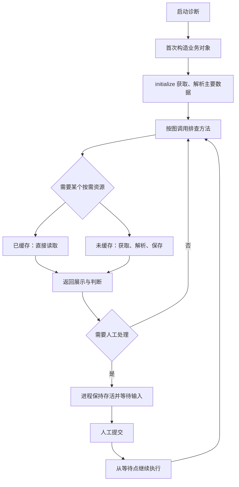

# NewDiag 诊断类开发手册

适用协议：`diagnosis/v1`，对应规格 v1.14。面向编写、接入业务诊断代码的开发者。
本文描述当前已实现的接口；设计契约以 [spec.md](spec.md) 为准。

开发路径：先运行现成 example，再替换数据接口与判断逻辑，最后在画布上编排方法。
无需给每个排查节点编写适配器或配置四阶段，也无需编写整张图的执行循环。

## 1. 代码和流程如何对应

| 平台概念 | 业务代码 | 职责 |
|---|---|---|
| 一张诊断流程 | 一个 `Diagnosis` 子类 | 提供初始化、共享数据和排查方法 |
| 一次诊断执行 | 一个逻辑诊断实例 | 固定本次输入、隔离数据与缓存 |
| 启动准备 | `initialize(...)` | 获取、解析主要数据 |
| 自动排查节点 | 类的公开实例方法 | 使用数据，返回展示和判断 |
| 按需资源 | 带 `@resource(...)` 的方法 | 首次访问获取、解析，随后复用 |
| 人工动作／判断 | 平台待办 | 等待人提交，再按图继续 |

类由业务工程提供，画布选择它的方法并编排连接。平台将流程生成 Python，运行库调用方法并选择分支；平台附加待办、执行记录、回退及进程管理。

人工等待期间进程及对象持续存活，收到回复后从等待点继续。回退和并行新分支从已有数据恢复对象，不重新调用构造器或 initialize。



图中省略终止分支。人工判断提交本身只记录选择，不重跑之前的业务方法。

## 2. 先运行现成 example

完整文件在 [examples/diagnosis-instance](../examples/diagnosis-instance/README.md)，无需连接真实设备或数据服务器。

### 2.1 登记业务工程

在「工程」页面新增：

| 配置项 | 填写内容 |
|---|---|
| 名称 | `诊断实例示例`，必须与示例流程引用一致 |
| 工程路径 | 本仓库 `examples/diagnosis-instance` 的绝对路径 |
| 模块 | `diagnosis`，不带 `.py` |
| Python | 默认使用后端解释器；有业务依赖时填写对应解释器绝对路径 |
| 工厂 | 留空 |

点「接口」，应能发现 `MotorDiagnosis`。普通公开方法会出现在排查方法列表，`waveform` 被识别为资源方法，不作为画布排查入口。

工程路径和 Python 都是后端服务器上的路径。业务依赖安装在登记的解释器环境里。
SDK 由平台启动业务进程时提供，不需要业务工程依赖 FastAPI 或 SQLAlchemy，也不要另外复制一份 SDK 覆盖它。

在业务 IDE 中需要识别 `diagnosis_sdk` 时，将平台 `backend/app/worker` 加入 Python 搜索路径。
例如在本机开发终端设置，路径按实际位置替换：

```powershell
$env:PYTHONPATH = 'D:\Projects\NewDiag\backend\app\worker'
```

这个设置只帮助独立开发和 IDE 导入；平台调用不要求用户手工配置它。

### 2.2 导入、发布和执行

1. 导入 [workflow.json](../examples/diagnosis-instance/workflow.json)。
2. 点击画布空白处，在「流程属性 → 诊断实例」查看业务类、版本及构造配置。
3. 点击开始节点，查看 `device_id`、`time_point`。点击排查节点，查看绑定的实例方法。
4. 保存并发布，用默认 `motor-01` 和 `2026-11-05T08:00:00+08:00` 启动。
5. 处理人工动作，再填写波形判断依据并提交；观察等待后继续的排查。

启动报告应只获取、解析一次。波形在第一个需要它的节点才加载，后续节点及人工等待后的调用复用缓存。
用 `motor-02` 另起诊断，会沿电压正常分支结束，不加载波形。

另外两份流程分别覆盖：

| 示例 | 观察点 |
|---|---|
| [workflow-parallel.json](../examples/diagnosis-instance/workflow-parallel.json) | 启动时选择串行或并行；串行复用缓存，并行分叉后的新增缓存独立 |
| [workflow-requests.json](../examples/diagnosis-instance/workflow-requests.json) | 通道、解析倍率不同的请求各自加载，不误用缓存 |

## 3. 开发一个业务类

一个业务工程可以公开多个诊断类，一张流程只选择其中一个。建议模块只导出需要接入的类：

```python
from diagnosis_sdk import Diagnosis, resource

__all__ = ['MotorDiagnosis']
```

下面的完整实现可以配合示例的三份 workflow 使用。将它保存为业务工程的 `diagnosis.py`，
同目录放置示例的 [measurements.json](../examples/diagnosis-instance/measurements.json)
和 [waveforms.json](../examples/diagnosis-instance/waveforms.json)。带详细日志的版本见 [原始示例代码](../examples/diagnosis-instance/diagnosis.py)。

```python
"""完整诊断对象：启动准备报告，后续方法首次需要波形时加载并缓存。"""

import json
import logging
import os
from pathlib import Path

from diagnosis_sdk import Data, Diagnosis, resource

__all__ = ["MotorDiagnosis"]
logger = logging.getLogger(__name__)
BASE = Path(__file__).resolve().parent


class MotorDiagnosis(Diagnosis):
    version = "1.1.0"

    def __init__(self, voltage_limit: float = 210, waveform_limit: float = 5):
        self.voltage_limit = voltage_limit
        self.waveform_limit = waveform_limit
        logger.info("创建诊断对象 pid=%s；此处不获取、不解析业务数据", os.getpid())

    def initialize(self, device_id: str, time_point: str):
        self.device_id = device_id
        self.time_point = time_point
        logger.info("启动获取报告 device=%s time=%s", device_id, time_point)
        raw = (BASE / "measurements.json").read_text(encoding="utf-8")
        logger.info("启动解析报告")
        records = json.loads(raw)
        selected = next((row for row in records
                         if row["device_id"] == device_id and row["time_point"] == time_point), None)
        if selected is None:
            raise ValueError("设备在指定时间没有报告")
        self.dataset = Data(report=selected)

    @resource(version="1")
    def waveform(self, device_id: str, time_point: str, channel: str = "A", scale: float = 1):
        logger.info("首次获取波形 device=%s time=%s channel=%s scale=%s",
                    device_id, time_point, channel, scale)
        raw = (BASE / "waveforms.json").read_text(encoding="utf-8")
        logger.info("首次解析波形")
        records = json.loads(raw)
        selected = next((row for row in records if row["device_id"] == device_id
                         and row["time_point"] == time_point and row["channel"] == channel), None)
        if selected is None:
            return None
        return {"samples": [value * scale for value in selected["samples"]],
                "device_id": device_id, "time_point": time_point, "channel": channel}

    def check_voltage(self):
        report = self.dataset.report
        value = report["voltage"]
        return {"presentation": {"blocks": [{"type": "metrics", "items": [
            {"label": "母线电压", "value": value, "unit": "V"},
            {"label": "阈值", "value": self.voltage_limit, "unit": "V"},
        ]}]}, "result": value < self.voltage_limit,
            "reason": f"启动报告电压 {value}V，与阈值 {self.voltage_limit}V 比较"}

    def check_waveform(self, channel: str = "A", scale: float = 1):
        value = self.waveform(self.device_id, self.time_point, channel, scale)
        return self._waveform_result(value)

    def review_waveform(self):
        value = self.waveform(device_id=self.device_id, time_point=self.time_point)
        result = self._waveform_result(value)
        result.pop("result")
        result.pop("reason")
        return result

    def confirm_waveform(self):
        logger.info("等待后继续使用固定数据 pid=%s", os.getpid())
        value = self.waveform(self.device_id, self.time_point)
        return self._waveform_result(value)

    def _waveform_result(self, value):
        if value is None:
            raise ValueError("指定设备、时间、通道没有波形，不能当作正常判断")
        peak = max(value["samples"])
        return {"presentation": {"blocks": [
            {"type": "text", "text": f"设备 {value['device_id']}，时间 {value['time_point']}，通道 {value['channel']}"},
            {"type": "line", "values": value["samples"]},
            {"type": "metrics", "items": [{"label": "峰值", "value": peak}]},
        ]}, "result": peak > self.waveform_limit,
            "reason": f"波形峰值 {peak}，阈值 {self.waveform_limit}"}

    def close(self):
        logger.info("释放诊断对象 pid=%s", os.getpid())
```

替换成真实业务接口时，主要改两处：`initialize` 中的主要数据获取、解析，以及 `@resource` 方法内的按需获取、解析。
排查方法继续使用准备好的数据，返回展示和判断。

### 3.1 方法发现规则

| 写法 | 平台如何使用 |
|---|---|
| `__init__(...)` | 创建 Python 对象，参数来自流程构造配置 |
| `initialize(...)` | 实例首次启动时执行，参数来自启动上下文 |
| 普通公开实例方法 | 可选为排查节点入口 |
| `@resource(...)` 方法 | 按需资源入口，不出现在排查方法列表 |
| `_helper(...)` | 内部辅助方法，不作为节点入口 |
| `close()` | 对象释放时关闭业务资源，可不实现 |

不要把仅供内部使用的辅助函数命名成公开方法，否则它也会进入接口描述和排查方法列表。
一个节点方法调用另一个 Python 方法只是代码复用，不会额外创建画布节点、运行记录或待办；
例如上面的 `review_waveform` 调用 `check_waveform`，平台只记录当前画布节点的一次执行。

公开接口必须同步、参数显式命名并支持关键字传参；不支持 `async def`、`*args`、`**kwargs` 或位置专用参数。
默认值必须能用 JSON 表达。`version` 和资源的 `version` 都必须是非空字符串。

### 3.2 首次创建与等待

首次启动按 `__init__` → `initialize` 执行。模块自有的数据对象使用 `Data`，名称可自定，例如 `self.dataset`；平台不规定其业务字段。小型固定配置仍可使用普通成员。
人工等待只阻塞进程，不重建对象、不重新获取或解析数据。回退时复用目标到访结果，恢复固定数据后直接调用新后继。

可以直接构造业务类、调用 initialize 和普通方法进行独立开发；没有运行上下文时，`@resource` 按普通方法执行。完整流程运行使用生成目录中的 `python flow.py`，人工输入由终端接收。

## 4. 参数分别放在哪里

| 参数类型 | 例子 | 配置位置 | 代码读取方式 |
|---|---|---|---|
| 流程构造配置 | 阈值、服务地址、算法选项 | 流程属性中的初始化配置 JSON | `__init__` 显式参数 |
| 本次诊断输入 | 设备、查询时刻 | 开始节点声明，启动时填写 | `initialize` 参数，通常保存到自定成员 |
| 节点专用参数 | 采样数组、阈值、现场文件 | 节点参数来源选「执行到此节点时填写」；也可用启动参数或 doc 的 `params` | 节点方法显式参数 |
| 资源请求参数 | 设备、文件哈希、时间范围、解析选项 | 业务代码调用资源方法时传入 | `@resource` 方法显式参数 |

推荐在 initialize 中正常保存参数，例如 `self.device_id = device_id`，后续方法直接读取成员。
`self.inputs` 作为旧接入的便捷入口保留；业务自己定义同名成员时不会被平台覆盖。
业务参数可以统一声明在 initialize 中，并不必须使用构造配置；当前页面保留构造配置以兼容已有类。
类型注解用于接口发现和表单控件，不代替业务参数校验，也不会自动把字符串解析成 Python `datetime` 等对象。

方法参数沿用发布期绑定优先级：节点显式 `params`、方法局部启动参数、全局启动参数、唯一的上游同名输出、Python 默认值。
函数作用域的名字是 `类名.方法名`，例如 `MotorDiagnosis.check_waveform`；初始化作用域为类名 `MotorDiagnosis`。

要让同一个 `check_waveform` 在两个节点使用不同通道，可以在流程 JSON 中分别配置：

```json
{
  "id": "check_channel_b",
  "kind": "investigation",
  "method": "check_waveform",
  "params": {
    "channel": {"lit": "B"},
    "scale": {"lit": 2}
  }
}
```

上面是节点配置片段，省略标题、说明、位置和连接，不能单独作为完整流程导入。
固定常量绑定可参考 [workflow-requests.json](../examples/diagnosis-instance/workflow-requests.json)。
当前实例方法面板提供方法选择和参数提示；完整的节点级 `params` 来源编辑通过流程 JSON 配置，不能假定已有四阶段参数编辑器。

### 4.1 文件、数组和对象怎么传

开始节点与节点现场表单均支持以下类型；字段类型可在页面选择，不要求修改业务结构：

| 页面类型 | 输入示例 | Python 接收值 |
|---|---|---|
| 文本 | motor-01 | `str` |
| 数字 | 3.5 | `int` / `float` |
| 布尔 | 是／否 | `bool` |
| 时间 | 选择时间 | 含时区的 ISO8601 `str` |
| 上传文件 | 从本机选择文件 | 服务器上已上传文件的绝对路径 `str` |
| 数组 | `[1, 2, 3]` | `list` |
| 对象 | `{"max": 3, "channels": ["A", "B"]}` | `dict` |
| JSON（任意结构） | 数组、对象、数字、字符串、布尔或 `null` | 对应的普通 Python 值 |

数组和对象用 JSON 格式填写，支持嵌套；不是把整个 JSON 当字符串传给方法。`[]`、`{}` 与 JSON 的 `null` 都是有效值。
注解 `list[...]`、`dict[...]` 会自动推荐数组、对象；文件路径若注解为 str，需手动选择「上传文件」。
平台只校验 JSON 结构及字段基本类型；数组元素、对象必需键和业务规则由方法自己校验。
页面参数用 JSON 表达；业务中的自定义对象、DataFrame 等仍可按普通 Python 成员保存，不必变成页面输入类型。

例如业务只需保持普通写法：

```python
def initialize(self, report_path: str, channels: list[str], options: dict):
    self.report = json.loads(Path(report_path).read_text(encoding='utf-8'))
    self.channels = channels
    self.options = options
```

在开始节点将 report_path 设为「上传文件」。执行者启动时选择本机文件；平台上传、验证引用、解析服务器路径后才调用 initialize。
无须知道服务器目录，也不要把本机路径字符串填给服务器读取。若文件本来就在服务器且业务允许直接读取，可保留「文本」类型填写路径。

### 4.2 执行到节点再填参数

在排查节点选择实例方法后，每个参数都有来源下拉框。选择「执行到此节点时填写」，再选择「数组」「对象」「上传文件」等输入类型。
该节点到达前不要求提供参数；到达后出现「填写参数」待办，填写／上传完成后点「提交参数并执行」。
业务方法成功返回后才进入判断；若方法只返回展示、未给判断结果，会再出现人工判断待办。提交判断不会重跑方法。

保留「自动绑定」时沿用上述参数优先级；仍找不到来源的必填方法参数自动转为现场填写，可选参数使用 Python 默认值。
initialize 在启动时执行，其必填参数仍需在开始节点准备；后续才有的数据应放到节点方法入参。
现场提交失败保留表单待办可重试；两次人工等待之间，普通 self 成员和已有缓存仍按整对象保存恢复。

完整可导入示例见 [文件上传与现场参数](../examples/interactive-inputs/README.md)，包含报告上传初始化、采样数组、阈值对象、现场证据上传和判断后恢复。

## 5. 普通成员与按需缓存

### 5.1 模块自有的一次写入数据对象

```python
from diagnosis_sdk import Data

# initialize 中创建，业务字段和加载时机由模块决定。
self.dataset = Data(report=report)

# 节点需要时再加载；未定义成员表示尚未取得。
if 'waveform' not in self.dataset:
    self.dataset.waveform = load_waveform()
value = self.dataset.report['voltage']
```

同一成员首次填充后禁止覆盖或删除；另一种数据形态使用另一成员。例如原始字节放 raw_report，解析结果放 report。
dict、list、set 会递归变为只读映射、元组、冻结集合；自定义类、数组等由模块保证不修改。None、零、空集合均是已取得值，不代表“尚未加载”。
不能放网络连接、锁、文件句柄或变化的“当前步骤”到数据容器；节点结论通过返回值交给运行记录。
人工输入应先校验再写入固定成员；业务校验失败保留原待办，允许修正未被接受的输入。
不要在普通成员中另外保留同一份大数据，否则仍会进入兼容对象快照。

每次保存只写新成员内容；之前的成员使用产物引用，不扫描整个内存对象寻找变化，也不复制整份数据。读取不返回副本。

### 5.2 按需缓存：@resource

带装饰器的方法包住获取和解析，正常调用即可：

```python
first = self.waveform('motor-01', '2026-11-05T08:00:00+08:00')
again = self.waveform(
    device_id='motor-01', time_point='2026-11-05T08:00:00+08:00', channel='A', scale=1,
)
```

上述有效参数相同，复用同一份结果。显式传参、关键字顺序和省略默认参数会按方法签名归一。
不同设备、时刻、通道、倍率分别缓存。缓存范围是本次诊断，不跨诊断实例共享。
平台缓存存放在对象外，不占用业务的 self.cache、self.data 或 self.inputs 名称。
资源结果支持 Python 对象快照，不要求先转换成 JSON；缓存读取仍返回隔离副本。

缓存键包含诊断类身份、版本、构造配置、初始化输入、资源方法名、资源版本及全部绑定后的资源参数。
启动输入、构造配置和缓存请求键仍使用 JSON 可表达的值；这不限制业务成员及资源返回值的 Python 类型。
业务方须把会改变结果的输入明确写进资源方法参数：

| 数据来源 | 应明确传入的内容 |
|---|---|
| 设备数据 | 设备标识、业务查询时刻或时间范围 |
| 文件 | 文件身份；文件可能被替换时使用内容哈希，不能只靠路径 |
| 查询接口 | 实际查询条件、数据范围 |
| 解析算法 | 通道、倍率、过滤条件等解析参数 |

不要让资源只根据未传入参数的可变 self 成员、全局变量或窗口中的值改变输出，这些变化无法自动进入缓存键。
查询“当前时间”时，由调用方先确定实际查询时刻，再作为参数传入；画布执行位置不代表业务查询时刻。

### 5.3 空结果、异常与并发

- `None`、空列表、空字典等正常返回值也会缓存。
- 读取失败、解析失败要抛异常，不要返回 `None` 冒充成功，否则它会成为成功的空缓存。
- 同一资源键的并发请求合并加载，等待者共享该次结果；失败不成为成功缓存。
- 节点在资源加载成功后判断失败，已成功加载的资源仍会保存，后续重执行可以复用。
- 串行路径共用缓存。并行路径真实分进程，分叉前的数据可继承，分叉后的加载独立，不做跨进程缓存合并。

业务异常不会自动重试整个节点；“失败不缓存”只表示后续再次请求仍可加载。
新引擎对超时或进程崩溃结束当前路径，释放名额继续队列；不自动重跑已完成节点。业务取数接口应只读。

### 5.4 保存边界与兼容

`Data` 成员使用 Python 产物保存一次，业务对象快照中的 Data 仅保存成员引用。节点输出单独保存，并由到访历史引用。
旧普通成员仍支持 pickle 整体保存，不自动获得增量效果；大数据应迁移到 Data。已有 `@resource` 返回值仍只保存首次结果，读取返回隔离副本以维持旧契约。
没有序列化能力的成员会明确报错，不静默省略；本轮不实现任意连接、会话、线程或调用栈恢复。
Python 产物只从本实例创建的存储恢复，不把上传附件当作 pickle 加载。展示仍使用 JSON／blocks 协议。

## 6. 排查方法返回什么

### 6.1 自动判断

```python
return {
    'presentation': {
        'blocks': [{'type': 'text', 'text': '当前电压 205V，阈值 210V'}],
    },
    'result': 'yes',
    'reason': '205V 低于 210V',
    'data': {'voltage': 205},
}
```

| 字段 | 要求 |
|---|---|
| `presentation` | 必填，必须是 `{'blocks': [...]}` |
| `result` | `True`／`False` 或小写 `'yes'`／`'no'`；空或省略表示人工判断 |
| `reason` | 自动判断必填非空字符串 |
| `data` | 可选，供运行记录及下游使用的额外 JSON 结果 |

`yes` 和 `no` 对应画布的是／否出口。数据读取失败、解析失败不是“否”，应抛异常。
不要只返回布尔值，也不要只打开桌面窗口；新协议要求返回带 `presentation` 的结构。

额外 `data` 会保存为产物，运行记录的 `output.data` 保留引用。需要传给下游参数时沿用节点 `params`：

```json
{
  "voltage": {"run": "previous_check", "path": "output.data.voltage"}
}
```

这是 `params` 内容片段，`previous_check` 必须是当前节点合法的上游来源。

### 6.2 人工判断

只返回展示，或将 `result` 设为 `None`：

```python
return {
    'presentation': {
        'blocks': [{'type': 'line', 'values': [1, 2, 6, 3, 1]}],
    },
    'result': None,
}
```

平台保存本次展示并生成判断待办，业务进程持续存活。
执行人填写依据并选是／否后，平台直接推进分支，不重新调用该方法。
后续节点如果需要业务对象，会重新构造并恢复已有数据。

人工处置、排查动作、转交等仍使用画布中的人工节点，无需为它们编写业务方法。

### 6.3 展示块

当前支持文本、指标、表格、折线、图片五种块，可以在同一 `blocks` 数组中组合。
前四种的写法如下：

```python
{
    'blocks': [
        {'type': 'text', 'text': '检查母线电压'},
        {'type': 'metrics', 'items': [{'label': '电压', 'value': 205, 'unit': 'V'}]},
        {'type': 'table', 'columns': ['通道', '电压'], 'rows': [['A', 205], ['B', 220]]},
        {'type': 'line', 'values': [205, 206, 204]},
    ],
}
```

表格每行长度与列数一致；折线数值列表不能为空，且必须是有限数字。
展示使用平台组件，不执行外部 HTML 或 JavaScript，不嵌入桌面窗口。

图片先通过平台附件上传或 `POST /api/files` 上传，使用返回的 `hash`，不要直接填图片文件路径。
如果业务报告已经包含上传图片的摘要，可以返回：

```python
{
    'type': 'image',
    'src': self.report['screenshot_hash'],
    'alt': '母线电压波形截图',
    'caption': '本次诊断使用的波形截图',
}
```

将此块放入 `presentation.blocks`。`src` 填附件摘要时必须是 64 位小写十六进制 SHA-256 摘要，不能带 `sha256:` 前缀；
`alt`、`caption` 可省略，出现时必须是字符串。不接受本地路径、外部 URL 或 base64 内联图片。
建议上传 PNG、JPEG、WebP 等平台支持在线预览的图片格式；SVG 不在内联白名单中。
业务进程只校验块格式，图片文件缺失或加载失败时，页面显示「图片不可用」。

执行待办与历史记录中的图片、曲线都可点击，在独立浏览器窗口放大查看。查看页提供放大、缩小、适应窗口，图片另有原始尺寸；无需修改业务返回结构。
窗口默认完整显示图形，放大后可滚动查看细节。打开查看页不会重新执行方法，关闭窗口也不会提交人工判断或改变诊断状态。
如果浏览器拦截新窗口，按页面提示允许本站点弹窗后重新点击。

#### 函数自己生成图片（matplotlib / PIL）

现场画出来的图不用先上传，直接把 `bytes` 放进 `src`，平台负责落盘并换成摘要：

```python
import io
import matplotlib
matplotlib.use('Agg')          # 无窗口环境必须用 Agg，交互后端会起 GUI
import matplotlib.pyplot as plt


def present(parsed):
    figure, axes = plt.subplots(figsize=(6, 3))
    axes.plot(parsed['samples'])
    buffer = io.BytesIO()
    figure.savefig(buffer, format='png')
    plt.close(figure)          # 不关会一路累积，长流程里很快吃满内存
    return {'blocks': [
        {'type': 'image', 'src': buffer.getvalue(), 'caption': '电压波形'},
    ]}
```

诊断类方法里同样适用：把这个块放进 `presentation['blocks']` 即可。

- `src` 只能是 `bytes`；`bytearray`、`memoryview` 会直接报错，先 `bytes(...)` 转一下。
- 类型**按文件头判定**，不看扩展名：只支持 PNG / JPEG / WebP / GIF。**SVG 一律拒绝**——它在 `` 里能执行脚本，改名成 `.png` 也过不了文件头检查；识别不出的一律拒绝。
- 单张上限 **10 MB**，超出直接报错；画图时控制分辨率和 DPI，别把整屏截图原样塞进来。
- 同一份字节重复生成只落一份（内容寻址去重），运行记录里只保存那个 64 字符摘要。
- 哈希可以是平台既有附件的摘要，也可以是这里现场生成的；两者在展示上没有区别。

注意：`bytes` 的转换挂在返回值序列化的必经之路上，所以**除下面提到的旧式普通函数外，任何阶段的返回值里出现 `bytes` 都会被换成摘要字符串**，不只 `image.src`。例如 `parse` 返回 `{'chart': png}`，下游拿到的是 `{'chart': '<64位摘要>'}`。这是有意为之，但也意味着别指望把二进制透传给下游函数。

已知限制：旧式普通函数（没有 `protocol`、也没有四阶段 `pipeline`，走 `_run_call` 那条路）拿不到文件目录，在里面直接调 `save_file` 会报「fileRoot 缺失」；需要生成图片的节点请用四阶段配置或诊断类方法。

## 7. 在画布中配置自己的流程

1. 登记业务工程，确认能发现诊断类。
2. 新建流程，点击画布空白处，在「诊断实例」选择工程和类，填写构造配置 JSON。
3. 开始节点会根据接口探测展示初始化及方法参数。将启动所需设备、时间、文件等声明为启动参数，配置默认值和控件类型；后续才填写的参数在对应节点选择现场填写。
4. 新增排查节点，填写观察对象、取数方式、判定标准，在「排查方法」选择类的公开方法。
5. 连接是／否分支及人工节点，确保各路径有终点。留空方法的排查节点仍由人工判断。
6. 保存、发布，再在执行页填写启动参数并运行。

例如流程顶层绑定为：

```json
{
  "diagnosis": {
    "project": "诊断实例示例",
    "function": "MotorDiagnosis",
    "protocol": "diagnosis/v1",
    "version": "1.1.0",
    "config": {"voltage_limit": 210, "waveform_limit": 5}
  }
}
```

这是 doc 顶层片段，完整可导入文件仍需 `format`、`name`、`mode`、`nodes` 和 `edges`。
节点使用 `method` 选择方法，不再各自重复指定工程、类及获取／解析函数。

同一诊断类流程不能混用旧 `binding`、四阶段 `pipeline` 或 `dataPreparation` 节点。
历史流程不需要强制迁移；未配置诊断类的流程继续使用旧接入机制。
当前新建流程默认已有诊断实例配置骨架，但工程、类名和版本为空，需要实际选择后才能发布。
导入现有流程保持其原有配置，不会强制改成实例模式。

## 8. 人工等待、回退与并行

### 8.1 人工等待

生成代码发出待办并同步等待回复。平台由待办页面接收，独立运行由终端输入。等待期间进程和对象存活，等待时间不计入自动步骤超时。
没有 pickle 调用栈的步骤；数据保存用于分支与回退，不是恢复人工等待的前提。

### 8.2 回退

在人工等待、串行暂停或失败时，选择已完成的具体到访 B 和新的后继。B 的输出直接复用，不执行 B，不重问 B 的人工数据。
原进程及所有未完成路径、待办取消；新路径只继承 B 及祖先输出。固定数据保留该独立分支已经取得的内容，回退不会将已取得成员清空。
已有运行记录不删除，旧执行代消息不能再推进实例。开始和终止节点不能作为目标，生成引擎没有 retry 模式。

### 8.3 串行与并行启动配置

模式不属于流程设计，启动时选择。串行深度优先，一条思路失败后继续下一条同级思路；成功仍有队列时选择结束／继续。
并行把同级思路放入独立进程，原进程继续第一个子分支，其余排队；无后继只结束当前路径，不再次跳转同级路径。
上限默认 4，可设 1–128。人工等待占名额，分支退出释放名额。模块会话子进程属于分支，不另计一个排查名额。

### 8.4 平台重启

本轮不实现服务重启后自动续跑。常驻人工等待与平台进程重启是不同的场景。解释器及依赖环境仍由部署方维护。

## 9. 日志、定位和故障处理

业务代码使用标准 `logging`，推荐记录设备、业务查询时刻、资源名称和阶段耗时，避免输出整份大结果。
通过平台调用时，业务进程的 stdout 会重定向到 stderr；不要自行往 stdout 写平台协议响应。

需要查看业务日志转发时，启动后端前设置：

```powershell
$env:NEWDIAG_LOG_LEVEL = 'DEBUG'
```

默认平台日志在 `backend/logs/app.log`。实例 ID 可串联会话启动、调用、关闭与节点结果。
SDK 会记录「诊断资源首次加载」「诊断资源缓存命中」；完整 example 另外记录初始化和对象 pid。
判断是否重复采集，看资源加载日志和「诊断对象由快照恢复」日志。
示例 pid 可核对等待期间进程未更换；回退及并行新进程恢复数据时不重新运行构造器和 initialize。

| 现象 | 优先检查 |
|---|---|
| SDK 导入失败 | 是否通过平台登记调用；IDE 是否配置 worker 路径 |
| 工程找不到诊断类 | 模块名、工程路径、`__all__`、是否继承 `Diagnosis`、工厂是否留空 |
| 辅助函数出现在节点方法列表 | 是否忘记用 `_` 前缀，或忘记给资源方法加装饰器 |
| 初始化或旧函数发布提示必填参数缺少来源 | 开始节点声明、作用域、节点 `params`，以及 Python 默认值；实例方法无来源必填参数可现场填写 |
| 对象快照保存失败 | 查看具体成员类型的序列化错误；当前不自动排除成员，后续边界见 TODO |
| 等待后普通成员不符 | 核对所选到访的数据版本、对象快照和业务自身的序列化钩子，不能重新采集替代恢复 |
| 旧 self.data 在排查阶段写入报错 | 旧容器仍按兼容规则处理；新接入使用自有 Data 容器，例如 self.dataset |
| 资源反复获取 | 有效参数是否变化；是否发生超时／崩溃；是否进入独立的并行分支 |
| 缺数据却一直命中缓存 | 是否把失败转换成正常 `None`；需要失败时应抛异常 |
| 版本或接口与发布计划不符 | 是否覆盖了正在运行实例依赖的类、方法或资源定义 |
| 产物缺失／损坏 | 检查数据目录和备份，不能用重新采集伪装历史恢复 |
| 方法只返回 bool 后执行失败 | 新协议必须返回带 `presentation` 的对象 |

平台失败结果不会自动转成人工判断，也不会自动把错误解释成“否”。需要人工判断时，主动返回展示及空 `result`。

## 10. 发布、维护与旧模块迁移

### 10.1 版本管理

发布固定图编排及模块引用。新实例启动时读取当前模块，校验参数来源并复制源码；已经运行的实例继续使用自己的源码，下一次启动使用更新实现。
更新算法可继续使用兼容的旧 flow；删除方法、改变必填参数等不兼容变更仍需修改绑定并重新发布。版本值需准确反映模块变更。
源码副本不包括依赖环境，部署方仍须维护所用解释器及依赖包。旧解释引擎实例仍依赖原工程目录。

### 10.2 从已有业务类迁移

1. 将本次诊断的启动参数和主要数据准备放在 initialize；已有构造器只在首次创建时执行，恢复不重跑它。
2. 将共享大数据放入自有 Data 成员，先写一次再只读；删除节点对既有数据的原地修改。
3. 将后续才需要的数据加载提取为资源方法，补齐请求参数并添加 `@resource`。
4. 将各排查逻辑整理成公开方法，内部辅助逻辑使用 `_` 方法。
5. 将桌面展示替换为 `presentation.blocks`，将自动判断返回为 `result` 和 `reason`。
6. 不把连接、锁或文件句柄当作业务数据保存；保存失败时根据具体错误定位，不静默省略成员。
7. 在新流程中选择诊断类并编排方法；保留旧流程继续使用原协议，不原地改变其契约。

### 10.3 数据运维

默认备份整个 `backend/data`，包括 SQLite、上传文件、旧 `artifacts` 和新 `executions` 目录；设置了 `NEWDIAG_DATA_DIR` 时，备份实际配置的数据目录。
只备份数据库无法恢复业务产物。
产物不可变，暂不自动回收。不要按文件时间删除“看起来旧”的数据，历史运行和回退可能仍引用它们。
部署路径、日志及环境变量详见 [部署手册](deploy.md)。

## 11. 需要修改平台时看哪些代码

| 位置 | 作用 |
|---|---|
| [diagnosis_sdk.py](../backend/app/worker/diagnosis_sdk.py) | 业务类发现、共享数据、资源缓存、对象恢复、返回值校验 |
| [probe.py](../backend/app/worker/probe.py) | 独立进程中的类和方法接口探测 |
| [session.py](../backend/app/worker/session.py) | 业务进程请求分发与诊断运行时 |
| [compiler.py](../backend/app/services/compiler.py) | doc 校验、类绑定、方法参数编译 |
| [signatures.py](../backend/app/services/signatures.py) | 发布／运行的接口指纹 |
| [generated_runner.py](../backend/app/services/generated_runner.py) | 平台事件记录、待办、进程上限、回退 |
| [generated_runtime.py](../backend/app/worker/generated_runtime.py) | 生成代码的调用、分支推进和终端输入 |
| [data_store.py](../backend/app/worker/data_store.py) | 模块自有只读数据及新增成员引用 |
| [scheduler.py](../backend/app/services/scheduler.py) | 旧实例解释执行兼容 |
| [artifacts.py](../backend/app/worker/artifacts.py) | 不可变 JSON 产物、字段读取及 Python 对象快照 |
| [models.py](../backend/app/models.py) | `diagnosis_states` 引用记录，`seq` 确定保存顺序 |
| [FlowPanel.vue](../src/components/panels/FlowPanel.vue) | 流程诊断类配置 |
| [DiagnosisMethodEditor.vue](../src/components/panels/DiagnosisMethodEditor.vue) | 排查实例方法选择 |
| [types.ts](../src/domain/types.ts) | 前端 doc／plan 类型契约 |
| [test_diagnosis_instance.py](../backend/tests/test_diagnosis_instance.py) | 旧引擎检查；不作为生成引擎已验证的证据 |

修改平台前先读 [AGENTS.md](../AGENTS.md) 和 [spec.md](spec.md)，契约变化需同步规格与前后端类型。
当前用户约定需求开发完成后不要求主动测试；如果要推送，仍必须按仓库要求在仓库根目录执行：

```powershell
backend/.venv/Scripts/python -m pytest backend/tests -q
```

看到 pytest 汇总 `N passed` 且没有 failed/error 才能推送。UI 交付需要记录实际手工验证步骤和结果。

已有交付的实际检查和页面验收记录见 [diagnosis-instance-delivery.md](diagnosis-instance-delivery.md)。
