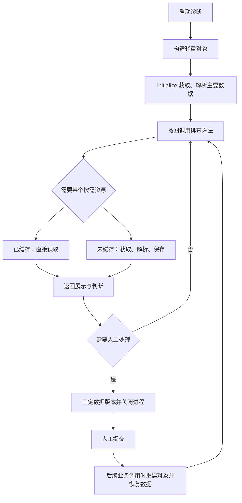

# NewDiag 诊断类开发手册

适用协议：`diagnosis/v1`，对应规格 v1.11。面向编写、接入业务诊断代码的开发者。
本文描述当前已实现的接口；设计契约以 [spec.md](spec.md) 为准。

开发路径：先运行现成 example，再替换数据接口与判断逻辑，最后在画布上编排方法。
无需给每个排查节点编写适配器或配置四阶段，也无需编写整张图的执行循环。

## 1. 代码和流程如何对应

| 平台概念 | 业务代码 | 职责 |
|---|---|---|
| 一张诊断流程 | 一个 `Diagnosis` 子类 | 提供初始化、共享数据和排查方法 |
| 一次诊断执行 | 一个逻辑诊断实例 | 固定本次输入、隔离数据与缓存 |
| 启动准备 | `initialize(...)` | 获取、解析主要数据 |
| 自动排查节点 | 类的公开实例方法 | 使用数据，返回展示和判断 |
| 按需资源 | 带 `@resource(...)` 的方法 | 首次访问获取、解析，随后复用 |
| 人工动作／判断 | 平台待办 | 等待人提交，再按图继续 |

类由业务工程提供，画布选择它的方法并编排连接。执行顺序、分支、人工待办、回退和终止由平台调度器管理。

同一次逻辑诊断不保证始终使用同一个 Python 内存对象：人工等待时会关闭业务进程，继续执行时重建对象并恢复数据。



图中省略终止分支。人工判断提交本身只记录选择，不重跑之前的业务方法；需要执行下一个业务方法时才重建对象。

## 2. 先运行现成 example

完整文件在 [examples/diagnosis-instance](../examples/diagnosis-instance/README.md)，无需连接真实设备或数据服务器。

### 2.1 登记业务工程

在「工程」页面新增：

| 配置项 | 填写内容 |
|---|---|
| 名称 | `诊断实例示例`，必须与示例流程引用一致 |
| 工程路径 | 本仓库 `examples/diagnosis-instance` 的绝对路径 |
| 模块 | `diagnosis`，不带 `.py` |
| Python | 默认使用后端解释器；有业务依赖时填写对应解释器绝对路径 |
| 工厂 | 留空 |

点「接口」，应能发现 `MotorDiagnosis`。普通公开方法会出现在排查方法列表，`waveform` 被识别为资源方法，不作为画布排查入口。

工程路径和 Python 都是后端服务器上的路径。业务依赖安装在登记的解释器环境里。
SDK 由平台启动业务进程时提供，不需要业务工程依赖 FastAPI 或 SQLAlchemy，也不要另外复制一份 SDK 覆盖它。

在业务 IDE 中需要识别 `diagnosis_sdk` 时，将平台 `backend/app/worker` 加入 Python 搜索路径。
例如在本机开发终端设置，路径按实际位置替换：

```powershell
$env:PYTHONPATH = 'D:\Projects\NewDiag\backend\app\worker'
```

这个设置只帮助独立开发和 IDE 导入；平台调用不要求用户手工配置它。

### 2.2 导入、发布和执行

1. 导入 [workflow.json](../examples/diagnosis-instance/workflow.json)。
2. 点击画布空白处，在「流程属性 → 诊断实例」查看业务类、版本及构造配置。
3. 点击开始节点，查看 `device_id`、`time_point`。点击排查节点，查看绑定的实例方法。
4. 保存并发布，用默认 `motor-01` 和 `2026-11-05T08:00:00+08:00` 启动。
5. 处理人工动作，再填写波形判断依据并提交；观察等待后继续的排查。

启动报告应只获取、解析一次。波形在第一个需要它的节点才加载，后续节点及人工等待后的调用复用缓存。
用 `motor-02` 另起诊断，会沿电压正常分支结束，不加载波形。

另外两份流程分别覆盖：

| 示例 | 观察点 |
|---|---|
| [workflow-parallel.json](../examples/diagnosis-instance/workflow-parallel.json) | 同级分支对相同资源请求只加载一次；改成串行仍可复用 |
| [workflow-requests.json](../examples/diagnosis-instance/workflow-requests.json) | 通道、解析倍率不同的请求各自加载，不误用缓存 |

## 3. 开发一个业务类

一个业务工程可以公开多个诊断类，一张流程只选择其中一个。建议模块只导出需要接入的类：

```python
from diagnosis_sdk import Diagnosis, resource

__all__ = ['MotorDiagnosis']
```

下面这份精简实现可以配合示例的三份 workflow 使用。将它保存为业务工程的 `diagnosis.py`，
同目录放置示例的 [measurements.json](../examples/diagnosis-instance/measurements.json)
和 [waveforms.json](../examples/diagnosis-instance/waveforms.json)。带详细日志的版本见 [原始示例代码](../examples/diagnosis-instance/diagnosis.py)。

```python
import json
from pathlib import Path

from diagnosis_sdk import Diagnosis, resource

__all__ = ['MotorDiagnosis']
BASE = Path(__file__).resolve().parent


class MotorDiagnosis(Diagnosis):
    version = '1.0.0'

    def __init__(self, voltage_limit: float = 210, waveform_limit: float = 5):
        self.voltage_limit = voltage_limit
        self.waveform_limit = waveform_limit

    def initialize(self, device_id: str, time_point: str):
        raw = (BASE / 'measurements.json').read_text(encoding='utf-8')
        records = json.loads(raw)
        report = next((item for item in records
                       if item['device_id'] == device_id
                       and item['time_point'] == time_point), None)
        if report is None:
            raise ValueError('指定设备和时间没有报告')
        self.data['report'] = report

    @resource(version='1')
    def waveform(self, device_id: str, time_point: str, channel: str = 'A', scale: float = 1):
        raw = (BASE / 'waveforms.json').read_text(encoding='utf-8')
        records = json.loads(raw)
        record = next((item for item in records
                       if item['device_id'] == device_id
                       and item['time_point'] == time_point
                       and item['channel'] == channel), None)
        if record is None:
            return None
        return {'samples': [value * scale for value in record['samples']]}

    def check_voltage(self):
        voltage = self.data.field('report', 'voltage')
        return {
            'presentation': {'blocks': [
                {'type': 'metrics', 'items': [
                    {'label': '电压', 'value': voltage, 'unit': 'V'},
                ]},
            ]},
            'result': voltage < self.voltage_limit,
            'reason': f'电压 {voltage}V，与阈值 {self.voltage_limit}V 比较',
        }

    def check_waveform(self, channel: str = 'A', scale: float = 1):
        value = self.waveform(
            self.inputs['device_id'], self.inputs['time_point'], channel, scale,
        )
        return self._describe_waveform(value)

    def review_waveform(self):
        result = self.check_waveform()
        result.pop('result')
        result.pop('reason')
        return result

    def confirm_waveform(self):
        return self.check_waveform()

    def _describe_waveform(self, value):
        if value is None or not value['samples']:
            raise ValueError('缺少有效波形，不能据此判断正常或异常')
        peak = max(value['samples'])
        return {
            'presentation': {'blocks': [
                {'type': 'line', 'values': value['samples']},
                {'type': 'metrics', 'items': [{'label': '峰值', 'value': peak}]},
            ]},
            'result': peak > self.waveform_limit,
            'reason': f'峰值 {peak}，阈值 {self.waveform_limit}',
        }
```

替换成真实业务接口时，主要改两处：`initialize` 中的主要数据获取、解析，以及 `@resource` 方法内的按需获取、解析。
排查方法继续使用准备好的数据，返回展示和判断。

### 3.1 方法发现规则

| 写法 | 平台如何使用 |
|---|---|
| `__init__(...)` | 创建 Python 对象，参数来自流程构造配置 |
| `initialize(...)` | 实例首次启动时执行，参数来自启动上下文 |
| 普通公开实例方法 | 可选为排查节点入口 |
| `@resource(...)` 方法 | 按需资源入口，不出现在排查方法列表 |
| `_helper(...)` | 内部辅助方法，不作为节点入口 |
| `close()` | 对象释放时关闭业务资源，可不实现 |

不要把仅供内部使用的辅助函数命名成公开方法，否则它也会进入接口描述和排查方法列表。
一个节点方法调用另一个 Python 方法只是代码复用，不会额外创建画布节点、运行记录或待办；
例如上面的 `review_waveform` 调用 `check_waveform`，平台只记录当前画布节点的一次执行。

公开接口必须同步、参数显式命名并支持关键字传参；不支持 `async def`、`*args`、`**kwargs` 或位置专用参数。
默认值必须能用 JSON 表达。`version` 和资源的 `version` 都必须是非空字符串。

### 3.2 构造器与启动初始化要分开

`__init__` 会在首次启动和人工等待后的恢复时执行。这里只保存配置或建立轻量环境，不获取报告、不解析文件。
`initialize` 负责本次诊断的主要数据准备，正常人工恢复不会再次调用它。

平台在构造器返回后才注入 `self.inputs`、`self.data`、`self.cache`，因此构造器里不能访问这些成员。
也不要直接用 `MotorDiagnosis().initialize(...)` 模拟平台执行：直接构造没有平台注入的数据容器。
调试接入应通过已登记工程和流程启动，让平台完成注入与恢复。

## 4. 参数分别放在哪里

| 参数类型 | 例子 | 配置位置 | 代码读取方式 |
|---|---|---|---|
| 流程构造配置 | 阈值、服务地址、算法选项 | 流程属性中的初始化配置 JSON | `__init__` 显式参数 |
| 本次诊断输入 | 设备、查询时刻 | 开始节点声明，启动时填写 | `initialize` 参数、`self.inputs` |
| 节点专用参数 | 某节点的通道、倍率 | 开始节点的方法参数，或 doc 中节点 `params` | 节点方法显式参数 |
| 资源请求参数 | 设备、文件哈希、时间范围、解析选项 | 业务代码调用资源方法时传入 | `@resource` 方法显式参数 |

`self.inputs` 保存传给初始化方法的启动参数，按只读使用。未作为初始化实参传入的其他节点参数，不应假定一定出现在这里。
类型注解用于接口发现和表单控件，不代替业务参数校验，也不会自动把字符串解析成 Python `datetime` 等对象。

方法参数沿用发布期绑定优先级：节点显式 `params`、方法局部启动参数、全局启动参数、唯一的上游同名输出、Python 默认值。
函数作用域的名字是 `类名.方法名`，例如 `MotorDiagnosis.check_waveform`；初始化作用域为类名 `MotorDiagnosis`。

要让同一个 `check_waveform` 在两个节点使用不同通道，可以在流程 JSON 中分别配置：

```json
{
  "id": "check_channel_b",
  "kind": "investigation",
  "method": "check_waveform",
  "params": {
    "channel": {"lit": "B"},
    "scale": {"lit": 2}
  }
}
```

上面是节点配置片段，省略标题、说明、位置和连接，不能单独作为完整流程导入。
固定常量绑定可参考 [workflow-requests.json](../examples/diagnosis-instance/workflow-requests.json)。
当前实例方法面板提供方法选择和参数提示；完整的节点级 `params` 来源编辑通过流程 JSON 配置，不能假定已有四阶段参数编辑器。

## 5. 共享数据、缓存与普通 self 成员

### 5.1 启动共享数据：self.data

在 `initialize` 中写入：

```python
self.data['report'] = report
```

节点里读取全部内容或某个字段：

```python
report = self.data['report']
voltage = self.data.field('report', 'voltage')
first_voltage = self.data.field('report', 'rows.0.voltage')
```

字段路径使用点分字典键与数组下标。`field` 按产物索引读取对应字段，不需要先加载整份报告。
取完整报告仍会加载并复制完整报告；它不是零成本访问。已有内存值会复用，读取提供隔离副本。

只有 `initialize` 可以写 `self.data`。后续排查计算出的新结果，通过节点返回值的 `data` 提供。
修改读取副本不会影响其他节点：

```python
report = self.data['report']
report['voltage'] = 0
# 这里只改了当前局部副本，共享报告不会变。
```

### 5.2 按需缓存：@resource

正常调用资源方法即可，不需要手动读写 `self.cache`：

```python
first = self.waveform('motor-01', '2026-11-05T08:00:00+08:00')
again = self.waveform(
    device_id='motor-01', time_point='2026-11-05T08:00:00+08:00', channel='A', scale=1,
)
```

上述有效参数相同，复用同一份结果。显式传参、关键字顺序和省略默认参数会按方法签名归一。
不同设备、时刻、通道、倍率分别缓存。缓存范围是本次诊断，不跨诊断实例共享。

缓存键包含诊断类身份、版本、构造配置、初始化输入、资源方法名、资源版本及全部绑定后的资源参数。
业务方仍须把会改变结果的输入明确写进资源方法参数：

| 数据来源 | 应明确传入的内容 |
|---|---|
| 设备数据 | 设备标识、业务查询时刻或时间范围 |
| 文件 | 文件身份；文件可能被替换时使用内容哈希，不能只靠路径 |
| 查询接口 | 实际查询条件、数据范围 |
| 解析算法 | 通道、倍率、过滤条件等解析参数 |

不要让资源只根据藏在可变全局变量或外部窗口中的值改变输出，这些变化无法自动进入缓存键。
查询“当前时间”时，由调用方先确定实际查询时刻，再作为参数传入；画布执行位置不代表业务查询时刻。

### 5.3 空结果、异常与并发

- `None`、空列表、空字典等正常返回值也会缓存。
- 读取失败、解析失败要抛异常，不要返回 `None` 冒充成功，否则它会成为成功的空缓存。
- 同一资源键的并发请求合并加载，等待者共享该次结果；失败不成为成功缓存。
- 节点在资源加载成功后判断失败，已成功加载的资源仍会保存，后续重执行可以复用。
- 当前同一实例的画布“并行”节点由调度器逐个调用；不要把并行分支理解为已承诺多个节点方法同时运行。

业务异常不会自动重试整个节点；“失败不缓存”只表示后续再次请求仍可加载。
平台对超时或进程崩溃重试一次，业务接口必须只读、可重复调用，不能把取数和修改设备状态放在一起。

### 5.4 哪些 self 成员会恢复

| 成员 | 等待后如何处理 |
|---|---|
| `self.data` 中的 JSON 业务数据 | 平台恢复对应的不可变产物引用，读取时按需解码 |
| `@resource` 的成功缓存 | 平台恢复请求键与产物引用，不再调用资源加载方法 |
| `self.inputs` | 平台恢复初始化实参 |
| 构造配置，如 `self.voltage_limit` | 由构造器根据已发布配置重新赋值 |
| 任意普通成员，如 `self.report` | 不自动保存；需要跨等待使用的数据改放 `self.data` 或资源返回值 |
| 连接、客户端、文件句柄、锁等 | 由业务代码重新创建，不能把活对象存入共享数据 |

可保存的值是 JSON 对象、数组、字符串、有限数字、布尔值和空值。
自定义类、DataFrame、日期对象等需在业务边界显式转换成这些数据；平台不使用 `repr` 冒充可恢复结果。
新协议没有自动保存整个 `__dict__` 的功能，也没有可随意恢复任意 Python 对象的通用钩子。

如果业务类根本没有连接、文件句柄等运行资源，就不需要为恢复额外创建这些东西；`close` 可以不实现。
确实需要连接时，在构造器或第一次使用时建立，在 `close` 中释放。重新建立客户端不等于重新采集业务数据。

## 6. 排查方法返回什么

### 6.1 自动判断

```python
return {
    'presentation': {
        'blocks': [{'type': 'text', 'text': '当前电压 205V，阈值 210V'}],
    },
    'result': 'yes',
    'reason': '205V 低于 210V',
    'data': {'voltage': 205},
}
```

| 字段 | 要求 |
|---|---|
| `presentation` | 必填，必须是 `{'blocks': [...]}` |
| `result` | `True`／`False` 或小写 `'yes'`／`'no'`；空或省略表示人工判断 |
| `reason` | 自动判断必填非空字符串 |
| `data` | 可选，供运行记录及下游使用的额外 JSON 结果 |

`yes` 和 `no` 对应画布的是／否出口。数据读取失败、解析失败不是“否”，应抛异常。
不要只返回布尔值，也不要只打开桌面窗口；新协议要求返回带 `presentation` 的结构。

额外 `data` 会保存为产物，运行记录的 `output.data` 保留引用。需要传给下游参数时沿用节点 `params`：

```json
{
  "voltage": {"run": "previous_check", "path": "output.data.voltage"}
}
```

这是 `params` 内容片段，`previous_check` 必须是当前节点合法的上游来源。

### 6.2 人工判断

只返回展示，或将 `result` 设为 `None`：

```python
return {
    'presentation': {
        'blocks': [{'type': 'line', 'values': [1, 2, 6, 3, 1]}],
    },
    'result': None,
}
```

平台保存本次展示与数据版本，关闭业务进程，生成判断待办。
执行人填写依据并选是／否后，平台直接推进分支，不重新调用该方法。
后续节点如果需要业务对象，会重新构造并恢复已有数据。

人工处置、排查动作、转交等仍使用画布中的人工节点，无需为它们编写业务方法。

### 6.3 展示块

当前支持文本、指标、表格、折线、图片五种块，可以在同一 `blocks` 数组中组合。
前四种的写法如下：

```python
{
    'blocks': [
        {'type': 'text', 'text': '检查母线电压'},
        {'type': 'metrics', 'items': [{'label': '电压', 'value': 205, 'unit': 'V'}]},
        {'type': 'table', 'columns': ['通道', '电压'], 'rows': [['A', 205], ['B', 220]]},
        {'type': 'line', 'values': [205, 206, 204]},
    ],
}
```

表格每行长度与列数一致；折线数值列表不能为空，且必须是有限数字。
展示使用平台组件，不执行外部 HTML 或 JavaScript，不嵌入桌面窗口。

图片先通过平台附件上传或 `POST /api/files` 上传，使用返回的 `hash`，不要直接填图片文件路径。
如果业务报告已经包含上传图片的摘要，可以返回：

```python
{
    'type': 'image',
    'src': self.data.field('report', 'screenshot_hash'),
    'alt': '母线电压波形截图',
    'caption': '本次诊断使用的波形截图',
}
```

将此块放入 `presentation.blocks`。`src` 填附件摘要时必须是 64 位小写十六进制 SHA-256 摘要，不能带 `sha256:` 前缀；
`alt`、`caption` 可省略，出现时必须是字符串。不接受本地路径、外部 URL 或 base64 内联图片。
建议上传 PNG、JPEG、WebP 等平台支持在线预览的图片格式；SVG 不在内联白名单中。
业务进程只校验块格式，图片文件缺失或加载失败时，页面显示「图片不可用」。

#### 函数自己生成图片（matplotlib / PIL）

现场画出来的图不用先上传，直接把 `bytes` 放进 `src`，平台负责落盘并换成摘要：

```python
import io
import matplotlib
matplotlib.use('Agg')          # 无窗口环境必须用 Agg，交互后端会起 GUI
import matplotlib.pyplot as plt


def present(parsed):
    figure, axes = plt.subplots(figsize=(6, 3))
    axes.plot(parsed['samples'])
    buffer = io.BytesIO()
    figure.savefig(buffer, format='png')
    plt.close(figure)          # 不关会一路累积，长流程里很快吃满内存
    return {'blocks': [
        {'type': 'image', 'src': buffer.getvalue(), 'caption': '电压波形'},
    ]}
```

诊断类方法里同样适用：把这个块放进 `presentation['blocks']` 即可。

- `src` 只能是 `bytes`；`bytearray`、`memoryview` 会直接报错，先 `bytes(...)` 转一下。
- 类型**按文件头判定**，不看扩展名：只支持 PNG / JPEG / WebP / GIF。**SVG 一律拒绝**——它在 `` 里能执行脚本，改名成 `.png` 也过不了文件头检查；识别不出的一律拒绝。
- 单张上限 **10 MB**，超出直接报错；画图时控制分辨率和 DPI，别把整屏截图原样塞进来。
- 同一份字节重复生成只落一份（内容寻址去重），运行记录里只保存那个 64 字符摘要。
- 哈希可以是平台既有附件的摘要，也可以是这里现场生成的；两者在展示上没有区别。

注意：`bytes` 的转换挂在返回值序列化的必经之路上，所以**除下面提到的旧式普通函数外，任何阶段的返回值里出现 `bytes` 都会被换成摘要字符串**，不只 `image.src`。例如 `parse` 返回 `{'chart': png}`，下游拿到的是 `{'chart': '<64位摘要>'}`。这是有意为之，但也意味着别指望把二进制透传给下游函数。

已知限制：旧式普通函数（没有 `protocol`、也没有四阶段 `pipeline`，走 `_run_call` 那条路）拿不到文件目录，在里面直接调 `save_file` 会报「fileRoot 缺失」；需要生成图片的节点请用四阶段配置或诊断类方法。

## 7. 在画布中配置自己的流程

1. 登记业务工程，确认能发现诊断类。
2. 新建流程，点击画布空白处，在「诊断实例」选择工程和类，填写构造配置 JSON。
3. 开始节点会根据接口探测展示初始化及方法参数。将设备、时间等声明为启动参数，配置默认值和控件类型。
4. 新增排查节点，填写观察对象、取数方式、判定标准，在「排查方法」选择类的公开方法。
5. 连接是／否分支及人工节点，确保各路径有终点。留空方法的排查节点仍由人工判断。
6. 保存、发布，再在执行页填写启动参数并运行。

例如流程顶层绑定为：

```json
{
  "diagnosis": {
    "project": "诊断实例示例",
    "function": "MotorDiagnosis",
    "protocol": "diagnosis/v1",
    "version": "1.0.0",
    "config": {"voltage_limit": 210, "waveform_limit": 5}
  }
}
```

这是 doc 顶层片段，完整可导入文件仍需 `format`、`name`、`mode`、`nodes` 和 `edges`。
节点使用 `method` 选择方法，不再各自重复指定工程、类及获取／解析函数。

同一诊断类流程不能混用旧 `binding`、四阶段 `pipeline` 或 `dataPreparation` 节点。
历史流程不需要强制迁移；未配置诊断类的流程继续使用旧接入机制。
当前新建流程默认已有诊断实例配置骨架，但工程、类名和版本为空，需要实际选择后才能发布。
导入现有流程保持其原有配置，不会强制改成实例模式。

## 8. 人工等待、回退与重新测量

### 8.1 正常人工等待

| 时机 | 执行内容 |
|---|---|
| 首次启动 | `__init__` → 平台注入容器 → `initialize` |
| 连续自动排查 | 复用存活对象及内存数据，逐节点保存数据版本 |
| 人工等待 | 保存数据与缓存版本，关闭会话、释放对象 |
| 继续后的业务调用 | `__init__` → 平台恢复容器与输入 → 调用后续方法 |

恢复时不调用 `initialize`，已有缓存不会再执行业务获取或解析。
从 JSON 产物解码、重建业务表达对象仍有开销，不应把“无需重新采集解析”理解为没有任何恢复成本。

### 8.2 回退绑定具体到访的数据

同一执行代的节点共享当前资源视图，包括同级分支。
回退创建新的执行代，继承所选那次到访的数据版本，不读取整个实例曾经出现过的“最新缓存”。

| 回退目标当时的状态 | 后续行为 |
|---|---|
| 已加载资源 A | 重执行目标节点时继续复用该版本 A |
| 尚未加载资源 A | 后续第一次需要 A 时才加载 |
| 较晚到访才加载资源 B | 回到较早到访时不会把 B 混入其资源视图 |

重执行节点会重新进行展示、判断等方法逻辑，不代表自动清空已有资源。
回退也不会撤销执行人已经完成的设备操作。

### 8.3 处置后需要新数据

人工处置不会隐式刷新缓存。例如旧请求查询 08:00 的电压，修复后再次查询 08:00，仍应得到原请求的历史数据。
需要复测时，让业务方法明确发起一个不同的新请求，例如传入 09:00 的测量时刻。
本次实现没有自动过期时间、清空全部缓存或通用刷新按钮，不要在接入代码里假设这些能力已经存在。

### 8.4 进程故障与平台重启

人工等待后的恢复属于当前实现。平台进程整体重启后自动续跑尚未实现。
超时、业务进程崩溃可能触发重试；若成功采集的数据尚未形成可用检查点，重试可能再次获取。
业务代码不能依赖“整个故障期间只调用一次”的保证。

## 9. 日志、定位和故障处理

业务代码使用标准 `logging`，推荐记录设备、业务查询时刻、资源名称和阶段耗时，避免输出整份大结果。
通过平台调用时，业务进程的 stdout 会重定向到 stderr；不要自行往 stdout 写平台协议响应。

需要查看业务日志转发时，启动后端前设置：

```powershell
$env:NEWDIAG_LOG_LEVEL = 'DEBUG'
```

默认平台日志在 `backend/logs/app.log`。实例 ID 可串联会话启动、调用、关闭与节点结果。
SDK 会记录「诊断资源首次加载」「诊断资源缓存命中」；完整 example 另外记录初始化和对象 pid。
判断是否重复采集，应看资源加载日志，不是只数构造器调用次数——等待后再次构造是正常行为。

| 现象 | 优先检查 |
|---|---|
| SDK 导入失败 | 是否通过平台登记调用；IDE 是否配置 worker 路径 |
| 工程找不到诊断类 | 模块名、工程路径、`__all__`、是否继承 `Diagnosis`、工厂是否留空 |
| 辅助函数出现在节点方法列表 | 是否忘记用 `_` 前缀，或忘记给资源方法加装饰器 |
| 发布提示必填参数缺少来源 | 开始节点声明、作用域、节点 `params`，以及 Python 默认值 |
| `self.data` 在构造器里不存在 | 容器在构造器返回后注入；把数据准备移到 `initialize` |
| 等待后 `self.report` 丢失 | 普通成员不持久化；业务数据应放 `self.data` 或资源返回值 |
| 排查时写共享数据报错 | `self.data` 仅初始化可写；派生结果从节点返回 |
| 资源反复获取 | 有效参数是否变化；是否发生超时／崩溃；是否回到尚未加载的历史版本 |
| 缺数据却一直命中缓存 | 是否把失败转换成正常 `None`；需要失败时应抛异常 |
| 版本或接口与发布计划不符 | 是否覆盖了正在运行实例依赖的类、方法或资源定义 |
| 产物缺失／损坏 | 检查数据目录和备份，不能用重新采集伪装历史恢复 |
| 方法只返回 bool 后执行失败 | 新协议必须返回带 `presentation` 的对象 |

平台失败结果不会自动转成人工判断，也不会自动把错误解释成“否”。需要人工判断时，主动返回展示及空 `result`。

## 10. 发布、维护与旧模块迁移

### 10.1 版本管理

`Diagnosis.version` 表示诊断类协议版本，`@resource(version=...)` 表示资源逻辑版本。
改动方法签名、构造配置、资源定义或数据格式后，更新对应版本并重新发布流程。
实现代码本身不会被平台归档；函数签名没变也不代表算法没变，算法变更仍需业务方管理版本。

如果旧实例还在等待，保留它依赖的旧工程代码和解释器。发布快照不能代替业务工程版本归档。
可以为不同部署版本使用独立工程目录和工程登记名，避免覆盖仍在使用的代码。

### 10.2 从已有业务类迁移

1. 将原构造器中的采集、解析移到 `initialize`，构造器仅保留配置和轻量环境。
2. 将需要跨节点、跨人工等待的数据放入 `self.data`；不要继续只赋值给任意普通成员。
3. 将后续才需要的数据加载提取为资源方法，补齐请求参数并添加 `@resource`。
4. 将各排查逻辑整理成公开方法，内部辅助逻辑使用 `_` 方法。
5. 将桌面展示替换为 `presentation.blocks`，将自动判断返回为 `result` 和 `reason`。
6. 将连接等运行资源的释放集中到 `close`；如旧业务类强制依赖窗口，先拆开或延迟创建无关依赖。
7. 在新流程中选择诊断类并编排方法；保留旧流程继续使用原协议，不原地改变其契约。

### 10.3 数据运维

默认备份整个 `backend/data`，包括 SQLite 和 `artifacts` 目录；设置了 `NEWDIAG_DATA_DIR` 时，备份实际配置的数据目录。
只备份数据库无法恢复业务产物。
产物不可变，暂不自动回收。不要按文件时间删除“看起来旧”的数据，历史运行和回退可能仍引用它们。
部署路径、日志及环境变量详见 [部署手册](deploy.md)。

## 11. 需要修改平台时看哪些代码

| 位置 | 作用 |
|---|---|
| [diagnosis_sdk.py](../backend/app/worker/diagnosis_sdk.py) | 业务类发现、共享数据、资源缓存、对象恢复、返回值校验 |
| [probe.py](../backend/app/worker/probe.py) | 独立进程中的类和方法接口探测 |
| [session.py](../backend/app/worker/session.py) | 业务进程请求分发与诊断运行时 |
| [compiler.py](../backend/app/services/compiler.py) | doc 校验、类绑定、方法参数编译 |
| [signatures.py](../backend/app/services/signatures.py) | 发布／运行的接口指纹 |
| [scheduler.py](../backend/app/services/scheduler.py) | 初始化、调用方法、待办、数据视图和回退 |
| [artifacts.py](../backend/app/worker/artifacts.py) | 不可变 JSON 产物及字段偏移读取 |
| [models.py](../backend/app/models.py) | `diagnosis_states` 引用记录，`seq` 确定保存顺序 |
| [FlowPanel.vue](../src/components/panels/FlowPanel.vue) | 流程诊断类配置 |
| [DiagnosisMethodEditor.vue](../src/components/panels/DiagnosisMethodEditor.vue) | 排查实例方法选择 |
| [types.ts](../src/domain/types.ts) | 前端 doc／plan 类型契约 |
| [test_diagnosis_instance.py](../backend/tests/test_diagnosis_instance.py) | 真实进程等待恢复、缓存与回退检查 |

修改平台前先读 [AGENTS.md](../AGENTS.md) 和 [spec.md](spec.md)，契约变化需同步规格与前后端类型。
当前用户约定需求开发完成后不要求主动测试；如果要推送，仍必须按仓库要求在仓库根目录执行：

```powershell
backend/.venv/Scripts/python -m pytest backend/tests -q
```

看到 pytest 汇总 `N passed` 且没有 failed/error 才能推送。UI 交付需要记录实际手工验证步骤和结果。

已有交付的实际检查和页面验收记录见 [diagnosis-instance-delivery.md](diagnosis-instance-delivery.md)。
