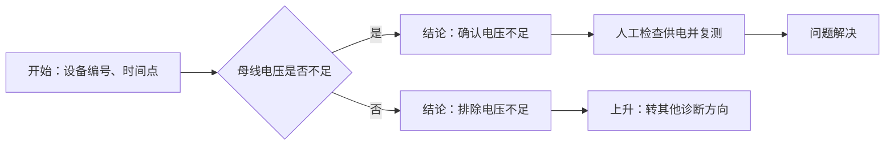
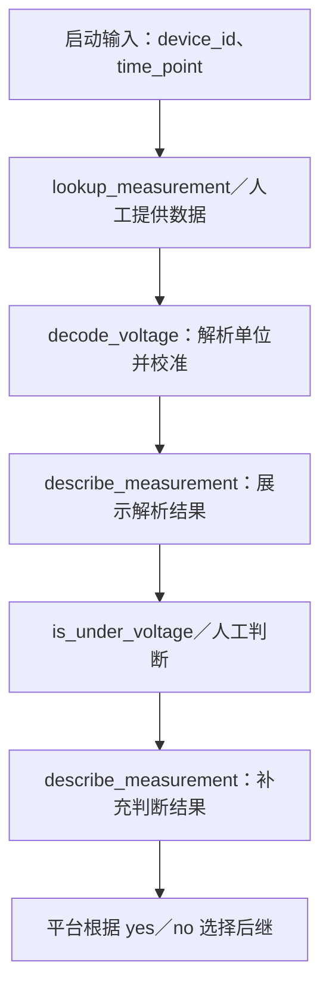

# 平台四阶段函数接入示例

在排查节点选择四个现有业务函数，由平台连接输入输出、创建人工待办并推进流程。
业务函数不继承平台 SDK，函数名不必叫 acquire、parse、present、judge，无需编写适配器类。
本示例仅使用标准库和离线数据，不需要数据服务器、桌面窗口或设备连接。

## 1. 从哪里开始

| 文件 | 用途 |
|---|---|
| [functions.py](functions.py) | 四个普通业务函数，理解接入代码从这里开始 |
| [external_module.py](external_module.py) | 内部使用的外部类，含必填构造参数 |
| [data/readings.json](data/readings.json) | 三台设备的离线原始数据 |
| [workflow-functions.json](workflow-functions.json) | 推荐先导入：自动采集、自动判断 |
| [workflow-functions-auto-acquire.json](workflow-functions-auto-acquire.json) | 自动采集、人工判断 |
| [workflow-functions-auto-judge.json](workflow-functions-auto-judge.json) | 人工采集、自动判断 |
| [workflow-functions-manual.json](workflow-functions-manual.json) | 人工采集、人工判断 |
| [CLASS_ADAPTERS.md](CLASS_ADAPTERS.md) | 旧适配器类及 HTTP 模式，仅作兼容参考 |

当前教程使用 workflow-functions*.json、工程名 `电压函数示例`、模块名 `functions`。
旧的 workflow.json 与 class_adapters.py 配套，见独立的兼容说明。

## 2. 流程图与节点内部执行

四份函数版流程的业务图相同，只有排查节点的函数配置不同。
JSON 包含节点坐标、启动参数、函数选择、参数映射和连线，可直接导入平台画布。



排查节点内部由平台按以下顺序调用：



“自动采集、自动判断”仅指排查节点内的两个阶段。后续供电处置仍为人工待办，平台不操作设备；
确认恢复后完成，未恢复则从执行轨迹回退重执行。“否”表示排除电压不足这一原因，转其他方向。

## 3. 登记、导入并启动

1. 在“工程”页登记以下信息：

   | 字段 | 填写值 |
   |---|---|
   | 名称 | `电压函数示例`，须与导入流程的引用一致 |
   | 工程路径 | 本目录绝对路径，例如 `D:\FILE\Projects\NewDiag\examples\voltage` |
   | 模块 | `functions`，不带 .py |
   | Python | 可用的解释器；本例可填平台 backend/.venv/Scripts/python.exe 的绝对路径 |
   | 工厂 | 留空 |

2. 查看接口，应看到 lookup_measurement、decode_voltage、describe_measurement、is_under_voltage。
3. 在“流程”页导入 [workflow-functions.json](workflow-functions.json)。
4. 选中“母线电压是否不足”，应看到接入方式为“分别选择四阶段函数”。
5. 发布并启动，保持 device_id=`motor-01`、time_point=`2026-11-03T10:00:00+08:00`。
6. 预期为 205 V，走“是”分支，等待人工检查供电并复测。完成处置后进入问题解决。

示例时间是离线档案的固定时间，试用时保留该值，不需要换成当前时间。
相对路径 data/readings.json 以登记的工程目录为基准；路径与解释器都在后端机器上。

## 4. 在界面上手工配置一次

也可以新建排查节点，在四栏选择工程 `电压函数示例`，按下表选函数。
配置与导入文件相同，不用修改 Python 代码或手写 plan。

| 栏位 | 函数 | 参数连接方式 |
|---|---|---|
| 获取数据 | lookup_measurement | 开始节点声明 device_id、time_point，平台按名称绑定 |
| 解析数据 | decode_voltage | payload 保持“自动连接”，接收完整原始数据 |
| 展示数据 | describe_measurement | measurement、result 保持“自动连接” |
| 判断结果 | is_under_voltage | value 选择“解析结果”，路径填 voltage；limit 选择“固定值”，填 210 |

展示的第一个参数自动接解析结果；第二个参数名为 result，因此自动接判断结果。
判断前 result 为 None；判断后为包含 result、reason 的对象。
自己的函数第二参数叫其他名字时，在参数面板显式选择“判断结果”即可。

limit 填数字 `210`；固定文本需使用 JSON 字符串，例如 `"说明文字"`。
字段路径 voltage 表示取出该字段，路径留空则传入完整对象。
默认阈值也是 210，所以 limit 也可选“使用函数默认值”。

## 5. 一次完整的数据传递

以 motor-01、默认校准系数 1.0 为例，下面是代码约定的数据形状。

**获取入参：**

```json
{"device_id": "motor-01", "time_point": "2026-11-03T10:00:00+08:00"}
```

lookup_measurement 创建取数对象，查询离线档案并返回：

```json
{"raw_value": 205000, "unit": "mV", "source": "离线示例数据／母线通道"}
```

**解析：**完整原始对象传给 decode_voltage 的 payload。
它调用分析类，将 mV 转为 V，并应用校准系数，返回：

```json
{"voltage": 205.0, "source": "离线示例数据／母线通道"}
```

**首次展示：**传入解析结果及 result=None，describe_measurement 返回文本
“实测电压：205 V；来源：离线示例数据／母线通道”。平台负责网页显示，函数不创建窗口。

**判断：**参数映射使 is_under_voltage 收到：

```json
{"value": 205.0, "limit": 210}
```

函数返回 True，平台规范为：

```json
{"result": "yes", "reason": "函数 is_under_voltage 返回 True"}
```

**最终展示与路由：**再次调用 describe_measurement，传入解析结果和判断对象，
返回文本增加判断及依据。平台保存原始数据、解析结果、每阶段实际参数和耗时，再推进“是”分支。
需要详细业务依据时，判断函数也可直接返回包含 result、reason 的对象。

## 6. 外部类有必填构造参数怎么办

DataArchive 要求 records_file、channel；VoltageAnalyzer 要求 calibration。
模块的公共业务接口创建对象时负责提供，代码就在 [functions.py](functions.py)：

```python
def lookup_measurement(device_id, time_point):
    archive = DataArchive(
        records_file=os.environ.get("VOLTAGE_RECORDS", "data/readings.json"),
        channel=os.environ.get("VOLTAGE_CHANNEL", "bus"),
    )
    return asdict(archive.read_at(device_id, time_point))

def decode_voltage(payload):
    analyzer = VoltageAnalyzer(
        calibration=float(os.environ.get("VOLTAGE_CALIBRATION", "1")),
    )
    return asdict(analyzer.parse(RawReading(**payload)))
```

平台没有猜测或消除构造参数。模块维护者在公共接口中管理真实依赖，流程用户只选择函数。
部署配置与本次诊断输入分开：

| 参数 | 谁提供 | 默认值 |
|---|---|---|
| records_file | 部署方设置 VOLTAGE_RECORDS | data/readings.json |
| channel | 部署方设置 VOLTAGE_CHANNEL | bus |
| calibration | 部署方设置 VOLTAGE_CALIBRATION | 1.0 |
| device_id、time_point | 执行人员填写启动表单 | 示例设备与固定时间 |
| limit | 流程编排者配置判断阈值 | 210 |

试用无需设置环境变量。实际部署由后端进程继承这些变量；生产模块使用自己的配置机制即可，
不要求采用示例变量名。环境配置不随流程版本归档，严格复现时需由部署方保留对应配置。

external_module.py 另有依赖 window、controller 的 DesktopApplication。
四个函数直接使用独立的取数和分析核心，不实例化桌面入口，因此无需填写窗口、控制器等无关参数。
若现有大类无法独立使用诊断功能，仍需模块方解除耦合；平台不会绕过构造函数或塞入假依赖。

## 7. 四种自动／人工组合

每个文件均可独立导入，使用同一工程登记，无需改代码：

| 文件 | 获取栏 | 判断栏 | 执行人员会看到什么 |
|---|---|---|---|
| workflow-functions.json | 已选函数 | 已选函数 | 自动排查后进入业务分支 |
| workflow-functions-auto-acquire.json | 已选函数 | 留空 | 展示电压后，填写依据并选择是／否 |
| workflow-functions-auto-judge.json | 留空 | 已选函数 | 填写原始数据，随后自动解析、展示和判断 |
| workflow-functions-manual.json | 留空 | 留空 | 填写数据，再查看展示、填写依据并判断 |

人工取数时，排查节点定义以下字段，由执行人员填写：

| 字段名 | 类型 | 示例填写值 |
|---|---|---|
| raw_value | 数字 | 205000 |
| unit | 文本 | mV |
| source | 文本 | 现场仪表记录 |

平台形成与自动取数同形状的原始对象，仍交给 decode_voltage 解析。
人工判断需填写非空依据，例如“实测205 V，低于210 V阈值”，再选择“是”。
人工等待保存数据，提交判断后只补充最终展示，不重新取数或解析。
四种组合都执行解析和展示；自动函数报错不会悄悄转成人工流程。

## 8. 预期结果与常见问题

固定时间点为 2026-11-03T10:00:00+08:00，校准系数为 1.0：

| 设备 | 原始值 | 解析后 | 自动判断预期 |
|---|---|---|---|
| motor-01 | 205000 mV | 205 V | 是 → 人工供电处置 |
| motor-02 | 230000 mV | 230 V | 否 → 排除电压不足 → 转其他方向 |
| motor-03 | 210000 mV | 210 V | 否；严格低于阈值才算不足 |

| 现象 | 检查位置 |
|---|---|
| 接口出现 ClassBased… 而不是四个函数 | 当前教程模块填 functions；类模式见兼容说明 |
| 发布提示工程不存在 | 登记名称为电压函数示例，路径为本目录绝对路径 |
| 指定设备、时间、通道找到 0 条数据 | 使用档案设备和固定时间，检查环境变量配置 |
| 判断参数类型错误 | value 取解析结果的 voltage 字段，而非完整对象 |
| 人工解析提示单位不支持 | unit 填 mV 或 V，区别大小写；读数与单位需对应 |
| 只有人工待办，没有自动判断 | 判断栏留空就是人工模式；自动模式选择 is_under_voltage |

以上为使用步骤和预期结果，不代表已执行浏览器手工验收。
完整数据契约与跨工程调用说明见[接入手册第0节](../../docs/module-integration.md)。
