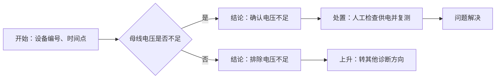

# 外部类接入：完整电压排查示例

## 首选：直接在平台配置四个函数

不想编写适配器类时，登记工程名称 `电压函数示例`，模块填 `functions`，路径为本目录绝对路径，工厂留空。
导入 [workflow-functions.json](workflow-functions.json)，节点已经选择下面四个函数：

| 阶段 | 现有业务函数 | 参数 |
|---|---|---|
| 获取 | lookup_measurement | 启动输入 device_id、time_point |
| 解析 | decode_voltage | 自动接收原始数据 |
| 展示 | describe_measurement | 自动接收解析结果、判断结果 |
| 判断 | is_under_voltage | 从解析结果取 voltage，阈值固定 210 |

函数代码在 [functions.py](functions.py)，无 SDK 导入，无适配器基类；平台根据节点配置调用，函数名不必固定。
数据仍使用 data/readings.json，输入 motor-01、2026-11-03T10:00:00+08:00 时为 205 V，应走是分支。
内部类所需的档案路径、通道、校准系数由业务模块管理，示例从环境变量读取并提供离线默认值。
需要覆盖时设置 VOLTAGE_RECORDS、VOLTAGE_CHANNEL、VOLTAGE_CALIBRATION；无需流程用户填写构造参数。

其他可导入变体：

- [workflow-functions-auto-acquire.json](workflow-functions-auto-acquire.json)：自动获取、人工判断。
- [workflow-functions-auto-judge.json](workflow-functions-auto-judge.json)：人工提供数据、自动判断。
- [workflow-functions-manual.json](workflow-functions-manual.json)：人工提供数据和判断，解析展示仍自动执行。

人工输入 raw_value=205000、unit=mV、source=现场仪表。详细配置和数据边界见
[手册第 0 节](../../docs/module-integration.md)。下面保留原适配器类模式，便于比较两种接入方法。

本示例包含可导入流程图、需要初始化参数的外部业务类、适配代码和离线数据。
仅使用标准库，无需数据服务器、桌面窗口或设备连接。
通用协议见[模块接入手册](../../docs/module-integration.md)。

## 目录与流程图

| 文件 | 用途 |
|---|---|
| [external_module.py](external_module.py) | 模拟已有业务模块，不依赖平台 SDK；保留数据对象与面向对象实现 |
| [class_adapters.py](class_adapters.py) | 对接平台四个方法；提供构造参数、延迟初始化和对象快照转换 |
| [data/readings.json](data/readings.json) | 三台设备的离线原始数据 |
| [workflow.json](workflow.json) | 自动采集／自动判断，建议先导入这一份 |
| [workflow-auto-acquire.json](workflow-auto-acquire.json) | 自动采集／人工判断 |
| [workflow-auto-judge.json](workflow-auto-judge.json) | 人工采集／自动判断 |
| [workflow-manual.json](workflow-manual.json) | 人工采集／人工判断 |
| [voltage.py](voltage.py) | 原有的简化／HTTP 接入示例，保留供参考 |

四份流程的业务结构相同，只切换排查节点绑定的适配器与初始化配置。JSON 包含节点坐标、
启动参数、四阶段绑定和是／否连线，导入后可直接在平台画布中查看、编辑和发布。



处置节点仍为人工待办，平台不操作设备。完成表示现场已经确认恢复；未恢复时从执行轨迹回退重执行。
“否”表示排除当前原因，不代表整个设备问题已经解决，因此示例转到其他诊断方向。

## 登记与导入

1. 在工程页登记以下信息，名称必须与流程绑定一致：

   | 字段 | 填写值 |
   |---|---|
   | 名称 | `电压类模块示例` |
   | 路径 | 本目录绝对路径，例如 `D:\FILE\Projects\NewDiag\examples\voltage` |
   | 模块 | `class_adapters` |
   | Python | 可用的业务解释器；本示例可使用平台 `backend/.venv/Scripts/python.exe` 的绝对路径 |
   | 工厂 | 留空 |

2. 查看工程接口，应列出下表的四个适配器类。
3. 在流程页导入本目录的 `workflow.json`，查看排查节点的绑定与配置，然后发布。
4. 启动时保持 `device_id=motor-01`、`time_point=2026-11-03T10:00:00+08:00`。
5. 自动分支应进入“确认电压不足”，显示 205 V；进入处置待办后由人确认完成。

默认使用本地文件，不需要另起 HTTP 服务。相对路径 `data/readings.json` 以登记的工程目录为基准。
也可填写后端机器上的绝对路径；浏览器用户电脑上的路径不能替代后端路径。

| 流程 | 适配器 | 初始化必填参数 |
|---|---|---|
| workflow.json | ClassBasedAutomaticVoltage | records_file、channel、calibration |
| workflow-auto-acquire.json | ClassBasedAcquisitionVoltage | records_file、channel、calibration |
| workflow-auto-judge.json | ClassBasedJudgmentVoltage | calibration |
| workflow-manual.json | ClassBasedManualVoltage | calibration |

每份流程已填写适配器版本及配置，无需手工修改 JSON 再导入。

## 带参数初始化的外部类如何接进来

`external_module.py` 中两个业务类都有必填构造参数：

```python
archive = DataArchive(records_file="data/readings.json", channel="bus")
analyzer = VoltageAnalyzer(calibration=1.0)
```

平台不直接无参创建这些外部类。它创建 `class_adapters.py` 中的适配器，由适配器负责传参：

```python
class ClassBasedAcquisitionVoltage(_ObjectVoltageBase):
    def __init__(self, records_file, channel, calibration, threshold=210):
        super().__init__(calibration, threshold)
        self.records_file = records_file
        self.channel = channel
        self._archive = None

    def acquire(self, device_id, time_point):
        if self._archive is None:
            self._archive = DataArchive(
                records_file=self.records_file,
                channel=self.channel,
            )
        return self._archive.read_at(device_id, time_point)
```

与之对应，`workflow.json` 的初始化配置是：

```json
{
  "records_file": "data/readings.json",
  "channel": "bus",
  "calibration": 1.0,
  "threshold": 210
}
```

调用关系：

```text
节点发布配置 → 适配器构造器 → 外部类构造器
本次启动输入 → acquire(device_id, time_point) → 外部对象.read_at(...)
```

records_file、channel、calibration 没有默认值，漏配会被发布检查拦住。
threshold 为可选的判断阈值，默认 210 V。
采集对象只在 acquire 实际执行时创建；分析对象只在解析或判断需要时创建。
接口探测不会为了读取方法签名而创建这些业务对象。

## 外部类还需要窗口、控制器，但当前功能不用怎么办

示例同时提供 `DesktopApplication(archive, analyzer, window, controller)`。
它需要窗口来显示数据，也提供设备控制功能；**平台适配器不会创建这个桌面入口类**，
而是直接组合 `DataArchive`、`VoltageAnalyzer`，因此不需要提供 window、controller。

```text
原桌面入口 DesktopApplication
    ├── DataArchive(records_file, channel)
    ├── VoltageAnalyzer(calibration)
    ├── window
    └── controller

平台适配器
    ├── DataArchive(records_file, channel) 仅自动采集时需要
    └── VoltageAnalyzer(calibration)
```

对应的改造要求是：将取数、解析和判断移到不依赖窗口的业务核心；桌面入口继续使用该核心。
不是让平台给 window、controller 传假对象，也不是让平台猜测可以省略哪些必填参数。

如果现有第三方类无法拆分，并且构造时必须打开窗口或连接控制器，适配器不能凭空消除这种依赖。
此时应保留桌面操作，通过人工数据提交接入，或由模块提供方增加独立的分析入口。

人工采集的两个适配器只要求 calibration：无需采集档案就不暴露 records_file、channel。
这演示了“当前功能不需要的初始化参数，应从当前适配器边界移除”。

## 保留原有对象与四阶段方法

外部模块在方法间传递 RawReading、ParsedVoltage、Assessment 对象，未改写成平台专属字典。
四个方法的职责在适配层对应如下：

| 平台方法 | 外部业务调用／处理 |
|---|---|
| acquire | DataArchive.read_at，返回 RawReading |
| parse | VoltageAnalyzer.parse，返回 ParsedVoltage |
| present | 根据 ParsedVoltage 生成平台指标展示描述 |
| judge | VoltageAnalyzer.assess，把 Assessment 转为是／否及依据 |

快照边界通过 dump_raw、dump_parsed 把 dataclass 保存为字典；
人工判断恢复时通过 load_parsed 重新创建 ParsedVoltage。
原有业务对象不用为平台重写；持久化转换由适配器明确负责。
自动／人工采集分别产生 RawReading／表单字典，parse 在适配层对齐这两种输入。

## 数据与四种模式的使用步骤

统一时间点为 `2026-11-03T10:00:00+08:00`、通道为 bus，默认校准系数 1.0：

| 设备 | 原始值 | 校准后电压 | 自动判断与预期分支 |
|---|---|---|---|
| motor-01 | 205000 mV | 205 V | 是 → 人工处置 → 确认后问题解决 |
| motor-02 | 230000 mV | 230 V | 否 → 排除电压不足 → 转其他方向 |
| motor-03 | 210000 mV | 210 V | 否；严格小于阈值才算不足 |

- **全自动**：导入 workflow.json，选择设备与时间，系统取数、解析、展示并判断。
- **自动采集、人工判断**：导入 workflow-auto-acquire.json，等待展示后填写依据并选择是／否。
- **人工采集、自动判断**：导入 workflow-auto-judge.json，提交原始读数、单位和来源后自动判断。
- **全人工边界**：导入 workflow-manual.json，先提交原始数据，再根据展示填写依据并选择是／否。

人工输入示例：raw_value=205000、unit=mV、source=现场仪表记录。
解析、展示在四种模式中都执行。自动取数找不到指定设备／时间／通道时报告错误，不自动改成人工采集。

以上为使用步骤和预期结果，不代表本次已经运行功能测试。

## 原 HTTP 示例

若需要接真实数据服务器，可另登记工程：名称自定、路径仍为本目录、模块填 `voltage`、工厂留空。
原四个适配器 ManualVoltage、AutomaticAcquisitionVoltage、AutomaticJudgmentVoltage、AutomaticVoltage
继续保留，但不与上述 class_adapters 流程混用。HTTP 模式需配置 data_url，可选 token_env；
查询参数为 deviceId、timePoint，预期响应包含 voltage，可选 source。

平台执行时提供 node_sdk；独立开发时的 Python 搜索路径设置见接入手册。
